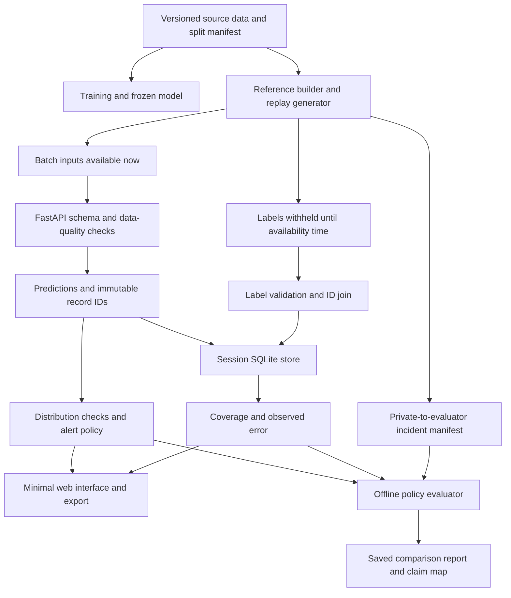

# ShiftWatch — fourteen-milestone build and learning plan

Prepared 12 November 2026; synchronized on 13 November and updated on 18 November 2026 (Asia/Calcutta). Latest user instruction: deadlines are strict; build the live project and deep intuitive understanding within 12–14 days. Working calendar counts 18 November as Day 1, targets release on 29 November (Day 12), and sets 1 December (Day 14) as the outer deadline. This is the assistant's stated interpretation of the relative deadline. Six focused learner hours/day includes teaching. No silent extensions; surface a forecast overrun and use the scope-cut order below. The removed interview date remains out of scope.

Current verified stage: **Day 1 is partial**. On 18 November the learner correctly answered that prediction performance cannot be measured without labels. This passes that narrow comprehension check, not the entire milestone. A health-only application is being added in this session. See `PROJECT_STATE.md` for verified runtime results; no dataset audit, model, evaluation, or deployment has been completed.

This plan supersedes `ShiftWatch-7-Day-Plan.md` and integrates the learner's 12 November clarifications: remove the interview deadline, prioritize end-to-end understanding, and have the assistant lead initial design and implementation while teaching progressively. The technical scope, evaluation contract, and honesty rules remain in force.

## 1. Objective, feasibility, and honest positioning

Build a publicly usable **batch ML monitoring and incident-replay application**. Demonstrate how data quality checks, distribution monitoring, and delayed-label performance tracking behave under known test conditions. Compare an uncomplicated alert policy with a more selective policy using a reproducible evaluator.

Build the project through **fourteen scheduled learning milestones**. Day 12 is the freeze/final-evaluation/release target after prerequisites pass; Days 13–14 protect defects, reproduction, independent understanding, and demonstration. The latest 12–14-day project deadline supersedes the earlier open-ended schedule. Do not ask for the removed interview date again.

The learner has confirmed **six focused hours per day** and **Git Bash**. Reading, teaching, guided implementation, reviewing assistant-written code, debugging, and verification all count. The budget is 72 hours through Day 12 and 84 overall; these are planned availability, not measured effort or a guarantee. Track remaining work against it. Raise overruns explicitly, cut permitted optional scope, and preserve correctness and learning gates; do not silently add days or represent missing understanding as complete.

This is the learner's first actual project. The assistant takes the initial design and implementation lead while developing the learner's independent understanding. Completion means the agreed acceptance criteria pass, no known release-blocking defect remains, the learner demonstrates the required skills after teaching/practice, and limitations are documented. A losing model/policy experiment is a result to report. No duration guarantees a problem-free system or complete mastery.

This project primarily supports **ML engineering, evaluation, and reliability/MLOps** interviews. It supplies little evidence of LLM application engineering or deep-learning training. Do not insert a neural network or LLM merely to change that description. CatalogLink can supply complementary modeling evidence later.

Monitoring is an established problem, and a general dashboard is not unique. Existing tools already implement distribution checks. The differentiator here is the explicit incident ground truth, delayed-label behavior, measured policy tradeoffs, and inspectable limitations. [Example of existing functionality](https://docs.evidentlyai.com/metrics/explainer_drift)

Use the title **ShiftWatch — Batch ML Monitoring and Reliability Evaluation**. A single-model prototype does not justify claiming an enterprise monitoring platform.

## 2. Exact problem, user, and product contract

### Problem statement

An engineer responsible for a batch prediction model receives new input records before their outcomes are available. They need to distinguish malformed inputs, changed input/prediction distributions, and observed prediction error. An alert should identify what changed, what evidence is available, and what investigation is appropriate. It cannot establish model deterioration from feature drift alone.

The initial user is an engineer maintaining one tabular regression model. The demonstration uses bike-rental data. No bike operator or paying customer has been established. Public data establishes a realistic workload, not adoption or business impact.

### Working solution

1. Load a documented example or start an isolated monitoring session for the supported model/schema.
2. Submit a bounded batch with stable record IDs and event times.
3. Validate it before prediction. Report malformed records without silently repairing them.
4. Make and retain predictions with the model/reference/policy versions.
5. Compare valid inputs and predictions with a frozen reference. Show warnings with sample sizes and test limitations.
6. Accept labels later by record ID. Show observed MAE/RMSE, label coverage, and label delay.
7. Show an alert timeline and downloadable JSON/CSV evidence.
8. Offer a controlled replay that reveals the injected scenario separately from the monitor's decisions.

Public visitors must be able to run the examples themselves. They can also use the documented CSV schema for this one model. Supporting arbitrary uploaded models, arbitrary schemas, and customer integrations is outside this release.

### Minimum frontend, implemented by the assistant on Day 11

One page with an example/scenario selector, batch submission, delayed-label submission or replay-step controls, three separate status panels, a timeline, and export. The panels are **data quality**, **distribution change**, and **observed performance**. Missing labels display “performance unknown,” with coverage. An empty/insufficient sample displays “insufficient data.” A drift p-value is never displayed as a probability that the model is wrong.

Frontend implementation is delegated to keep the learner's practice focused on the ML system and its evaluation. The assistant still teaches the frontend/backend contract, input handling, truthful displays, and error states. After guided practice, the learner verifies acceptance behavior and explains that contract.

## 3. Ownership and teaching agreement

The assistant leads initial design and implementation, including core functions, scaffolding, adapters, API handlers, storage, tests, Docker/CI, documentation, and the minimal frontend. It teaches the purpose, vocabulary, alternatives, implementation, and verification in manageable pieces. Demonstrating a core function does not require the learner to design it independently first. There is no typing quota.

The learner develops ownership of the problem definition, data/label assumptions, split design, detector interpretation, alert policy, evaluation denominators, deployment tradeoffs, and final claims through teaching and guided practice. This is a learning outcome rather than prior expertise. Eventually demonstrate understanding through explanations, traces, modifications, and debugging rather than only reading the code.

Teach every project layer as it becomes relevant: the problem and solution, unfamiliar vocabulary, design alternatives, architecture, folder structure, commands/tools, implementation, data/state flow, tests, evaluation, storage, API behavior, and deployment. Explain why a file or component exists and how it connects to the workflow. Reading supplements the teaching; it does not replace it or become a prerequisite for receiving an explanation. Genuine product decisions can still need learner input after the options are explained.

Use simple, connected lessons like a book, with implementation alongside the explanation: problem, reason for the design, worked example, small working piece, code/command trace, and one comprehension check. Integrate teaching into the build instead of spending repeated sessions only editing instructions. Save lessons as readable project material.

For each meaningful component:

1. Teach its purpose, unfamiliar terms, and input/output behavior using a small concrete example.
2. Walk through a worked example; recommend a design and explain the relevant alternatives and costs.
3. Implement or demonstrate a bounded piece and explain its important logic, structure, and checks.
4. Ask one small prediction/trace question about the material just taught and guide the learner's practice.
5. Address confusion with another explanation/example. Gradually move to independent traces, changes, and debugging once the prerequisites have been taught.
6. Save actual observations, decisions, and learning evidence; do not treat an untaught topic as a failed exercise.

After teaching and guided practice, the learner independently completes four small exercises: compute PSI on a tiny histogram, calculate event recall/delay on an alert timeline, trace a delayed-label join including a duplicate, and fix one failing core test. These remain eventual learning checkpoints. Pseudocode is acceptable before implementation, but each exercise ends with executable or inspectable evidence.

Use short explanations tied to the current problem. Record decisions as requirement, alternatives, choice, evidence, cost, and reversal condition. Record debugging as symptom, reproduction, hypothesis, smallest check, fix, and regression check. Do not paste large code changes without review or rush into later-day work while a learning checkpoint remains unresolved.

A milestone is complete only when its deliverables run, its checks pass, and the learner passes its explanation/practice checkpoint after the prerequisites have been taught. At a session review, state **complete**, **partial**, or **blocked**, list evidence and remaining work, update `PROJECT_STATE.md`, and give exactly one next task. Track implemented functionality separately from demonstrated understanding, including whether a task was demonstrated, guided, or independent. If a check reveals confusion, teach differently and retry. An untaught topic is not a failed checkpoint. The withdrawn opening independent-design assignment is not a learner failure.

Do not fabricate outputs, improvement, user feedback, deployment success, or understanding. Say when an assumption is unverified. Record assistant assistance honestly. Never claim sole manual authorship if asked.

## 4. Data, model, and split contract

### Source

Use the UCI **Bike Sharing** archive, specifically `hour.csv`. The publisher describes hourly/daily rental counts from 2011–2012 and a CC BY 4.0 license. Download using the archive link on the dataset page, retain attribution, and save the original file, source URL, retrieval date, and SHA-256 checksum. Inspect the actual CSV and README on Day 2. File row counts, gaps, duplicates, and category frequencies must come from that audit, not a copied web summary. [UCI source and download](https://archive.ics.uci.edu/dataset/275/bike+sharing+dataset)

Predict `cnt`. Exclude `casual` and `registered`, which are components of the target, as well as row IDs and evaluation metadata. Use a small allowlist of calendar/weather fields verified against the archive. This is a **retrospective batch estimate using contemporaneous weather**. It is not a future demand forecast using weather known in advance.

Use `DummyRegressor(strategy="median")` as the predictive baseline and one compact `HistGradientBoostingRegressor` as the candidate. A fitted preprocessing pipeline handles verified categorical/calendar fields consistently. Limit model variation to one justified change. Disable a hidden random early-stopping split or supply a supported explicit chronological validation procedure. Evaluate MAE primarily and RMSE secondarily. If the candidate fails to beat the dummy on development validation, inspect leakage/schema/underfitting before continuing. A weak result must remain visible. [Model documentation](https://scikit-learn.org/stable/modules/ensemble.html#histogram-based-gradient-boosting)

### Chronological roles

Sort by verified date/hour and assign whole dates to five consecutive roles, approximately 40%/10%/10%/20%/20% of dates:

| Role | Allowed use |
|---|---|
| Model training, first 40% | Fit preprocessing and candidate model |
| Model validation, next 10% | Compare dummy/candidate and at most one variation |
| Historical reference, next 10% | Freeze the reference for natural chronological replay and supported custom uploads |
| Policy development, next 20% | Build replay fixtures, select alert thresholds, and exercise the application |
| Final evaluation, last 20% | One locked evaluation after model, policy, scenarios, and evaluator are frozen |

Save exact boundaries, role counts, feature allowlist, and file hashes on Day 2. Do not shuffle before assigning roles. Inspect metadata/schema for the final role, but do not examine its outcomes or detector results during development. No automatic model refitting or reference refresh in this version. A real change to either creates a new version and needs reevaluation.

All learned preprocessing comes from training. There is no scaling, imputation fitting, feature selection, threshold setting, or bin adjustment using final outcomes. [Leakage and preprocessing guidance](https://scikit-learn.org/stable/common_pitfalls.html)

### Two distinct replay settings

**Controlled policy evaluation.** In each permitted role, independently sample whole-day blocks from its empirical pool with replacement to form a reference and approximately weekly batches. Preserve within-day order and report the actual row counts. Use a fixed recipe for reference size, block sampling, and incident placement. Different draws can reuse source records. This creates a controlled empirical environment, not independent new real-world incidents. All policies see identical reference/batches for each seed. Reference summaries for the final controlled replay are part of the predefined monitoring input, not newly fitted thresholds. Do not inspect them to change the system.

**Natural chronological replay.** Run the untouched final period in chronological batches against the earlier frozen historical reference. Report alerts and delayed-label error over time. There are no verified incident annotations here. Do not call its alert count a false-alarm rate or its natural changes confirmed concept drift.

These settings answer different questions and must appear in separate result tables. A stationary resampling experiment does not establish seasonally robust production monitoring.

## 5. Algorithms and alert-policy contract

### Three channels

| Channel | Initial implementation | Meaning and constraint |
|---|---|---|
| Data quality | Required fields, types, unique IDs, finite/range checks, missingness, category validation | Input contract violation. Missingness is evaluated before drift statistics can drop nulls. |
| Distribution | Numeric KS statistic and nominal p-value; fixed-bin PSI; categorical chi-square and total variation; prediction-distribution shift | Evidence of distribution differences, not proof of performance loss. |
| Performance | Delayed-label MAE, RMSE, coverage, age, and a frozen error threshold | Error among outcomes actually received. Partial/selective labels can bias it. |

Monitor a fixed small feature list, initially `temp`, `hum`, `windspeed`, `workingday`, `weathersit`, plus predictions. Confirm names and definitions from the file before freezing it. Calendar fields can still be model inputs. The shortlist limits the testing burden and does not cover all possible multivariate changes.

**KS.** Explain the maximum difference between empirical cumulative distributions. The usual p-value assumptions are not fully met by dependent hourly observations and tied/quantized features. Treat the p-value as a diagnostic input and evaluate actual policy behavior in replay. Never claim a 5% operational false-alarm guarantee from `p < 0.05`. [SciPy KS documentation](https://docs.scipy.org/doc/scipy/reference/generated/scipy.stats.ks_2samp.html)

**PSI.** Use `sum((current_share - reference_share) * log(current_share / reference_share))`. Fit up to ten quantile bins on the reference only, merge repeated edges, include out-of-range values in end bins, add a fixed documented pseudocount before normalizing, and monitor missingness separately. Constant features get an explicit supported case or “insufficient variation.” PSI is a descriptive divergence, not a p-value. Thresholds such as 0.2 are conventions to benchmark, not universal laws.

**Categories.** Use a 2-by-K reference/current count table. Freeze grouping using the reference, retain unseen-category counts separately, and return “insufficient evidence” if chi-square expected counts are too small under the declared rule. Do not regroup based on final results. Total variation is one-half the sum of absolute category-share differences. [Chi-square assumptions](https://docs.scipy.org/doc/scipy/reference/generated/scipy.stats.chi2_contingency.html)

### Exactly two distribution alert policies

**P0, naive comparator.** Alert in a batch if any eligible monitored column has a nominal KS/chi-square p-value below 0.05 or numeric PSI at least 0.2. Record this as a deliberately simple comparator. Keep the complete alarm history.

**P1, candidate.** Require nominal significance plus a minimum practical effect for the same feature in two consecutive eligible batches. Numeric effects use KS D, categorical effects use total variation. Compare only two prespecified effect levels, 0.1 and 0.2, on policy-development data. An ineligible batch breaks the persistence streak. Record PSI but do not add an extra OR trigger to P1. Do not imply formal multiple-testing control. Repeated tests, correlated features, and repeated reference use remain limitations.

Both policies use identical data-quality and delayed-performance rules. They differ only in the distribution-alert policy. Report channels separately so an unchanged quality rule cannot make an inferior distribution rule look better. A combined alert is a user-facing summary, not evidence of a new detector.

Select P1 only if, on policy-development controlled replays, its no-injection batch alarm rate is at most 5%, its covariate-event recall falls by no more than 10 percentage points relative to P0, and its median detected-event delay increases by at most one batch. If both effect levels qualify, choose higher event recall, then shorter delay, then lower alarm rate, then the smaller effect threshold as a fixed tie-break. Undefined recall/delay cannot pass the gate. These are proposed engineering selection criteria, not expected achievements or statistical equivalence. Freeze them before running comparisons. If neither candidate level qualifies, keep P0 as the measured comparator or display diagnostics without claiming improved alerting. Preserve the losing results.

### Delayed labels

Replay defaults to a **two-batch simulated delay**. At replay step `t`, expose only labels whose availability step is at most `t`. Store original prediction, record ID, model version, event time, received time, and label. Never recompute historical predictions with a later model. A label table join uses IDs, never row positions.

Identical retries are idempotent. Reject conflicting labels and unknown IDs explicitly. Do not silently overwrite. For performance-alert evaluation, use fully labeled matured batches with at least 100 predictions. Show partial-batch metrics and coverage descriptively, with no clean/healthy conclusion. Freeze a performance threshold from the 95th percentile of no-injection batch MAE in policy-development replay. This percentile does not guarantee a 5% future error-alert rate.

Report delay both from incident onset and from first eligible label availability. Flush the label queue after the last prediction batch. Do not let scenario names, injected labels, or future labels enter the monitor. Synthetic labels and scenario metadata belong to the replay/evaluation side.

## 6. Evaluation contract and required evidence

### Scenario suite

| Scenario | Construction | What it can establish |
|---|---|---|
| No injected change | Independent block draws from the same empirical pool throughout | Empirical background/false alerts under this controlled null setup |
| Covariate stress | Resample intact X/y pairs with probabilities based only on an observed feature, at two predefined strengths | Response to a changed feature mix. Record any changed temporal dependence. Do not presume worse prediction error. |
| Data-quality incident | Corrupt a declared proportion of required numeric values or introduce invalid values, with original rows retained for audit | Validation behavior and alert timing. Rejected rows must not become misleading model-error measurements. |
| Conditional-target stress | Keep X and predictions unchanged; modify y after onset using one fixed formula at two strengths, for example nonnegative rounded `1.25*y + 20` and `1.5*y + 40` | Artificial concept-change stress. Input-only detection can miss it, while delayed outcomes reveal error. It is not a real observed concept-drift label. |

Specify actual corruption fractions and sampling weights on Day 6 before running policy comparisons. Use one event per replay, for example eight pre-event batches, eight event batches, and eight post-event batches. Append label-flush steps. Keep event windows and channel-specific label-availability windows explicit.

Run 20 prespecified seeds per scenario/severity for development and a disjoint 20 seeds on final-role records. If runtime forces fewer, predeclare the reduction before final evaluation and report the actual count. Use paired seeds across policies. Do not label reused source records or repeated simulations as independent customer incidents. Report raw counts plus variability across replay seeds. Any bootstrap interval resamples whole replay units, and its interpretation stays conditional on this simulator and data pool.

### Metrics, denominators, and saved outputs

| Metric | Exact contract | Saved evidence |
|---|---|---|
| Predictive baseline quality | MAE/RMSE on identical validation/final rows, dummy versus candidate | `model_metrics.json`, prediction CSV |
| No-injection batch alarm rate | Alerted eligible batches / eligible batches in dedicated no-injection runs, separately by channel | `batch_metrics.csv` with raw counts |
| Alert burden | Number of alert episodes and batches in alert per 100 eligible batches | `alerts.csv`; contiguous alerts form one episode |
| Event recall | Events with a relevant-channel alert in the fixed detection window / all eligible injected events | `event_metrics.csv`; include misses |
| Detection delay | First relevant alert minus event onset; also label-adjusted delay for performance | Per-event onset, availability, alert index, and detected/missed status |
| Performance during drift | Paired original-versus-modified replay MAE/RMSE, with label coverage | `performance_metrics.csv` |
| Natural replay | Chronological alerts and observed error, with no presumed incident truth | Separate `natural_replay.csv` |
| Runtime | Warm p50/p95 batch endpoint latency, cold start separately, peak process RAM, input size, host, concurrency, repetition count | `runtime.json` and raw timing CSV |
| Usability | Tasks completed, misunderstandings, corrections, tester role, date | `usability.md`, clearly labeled scope |

For distribution/quality event recall, the detection window is the injected event interval. For performance, it is that event's delayed-label availability interval. Do not credit unrelated channels as correct detections. Post-event alarms outside these windows are reported as lingering alerts, rather than being silently dropped or automatically called false positives. Dedicated no-injection runs provide the primary controlled false-alarm denominator.

A missed event has no finite detection delay. Never remove misses from recall or convert them to zero delay. Report delay among detected events together with the total missed fraction. Handle zero denominators as undefined, not zero.

Freeze sample eligibility before comparison and use identical denominators for both policies. Initially require at least 100 valid numeric observations per reference/current sample for numeric statistics, plus the categorical expected-count checks above. Report per-feature exclusions. A batch with at least one eligible monitored feature is eligible for the distribution-policy comparison. P1's first eligible batch remains in the denominator even though persistence prevents it from alerting. Data-quality eligibility includes malformed submissions that the quality checker can inspect, and performance eligibility follows the matured-label contract. Do not lower measured alarm rates by excluding inconvenient eligible batches.

Before the final run, freeze code commit, model/reference hashes, policy, feature list, scenarios, seeds, metric definitions, and deployment configuration. Save raw outputs before writing conclusions. If final failures inform a redesign, mark that evaluation as consumed. A genuine evaluator bug requires an explicit invalidated-run record and corrected rerun, not quiet replacement.

### Human evidence

On Day 1, the learner asks a willing engineer, intern, or technically relevant contact to try the app on Day 11, with Day 12 as a scheduling fallback. Do not send messages on the learner's behalf without explicit instructions. Ask them to diagnose a quality incident, interpret an unlabeled batch, and export a report. Record errors and corrections. If no one is available, retain that gap openly. Builder self-testing is not external user validation, and a peer trial is not production adoption. User-trial examples use development data. Finish any behavior-changing corrections before the Day 12 final freeze, or document the effect on the evaluation's status.

## 7. Architecture, stack, and operational boundaries



The incident manifest is hidden from the detector, not a security boundary or confidential user record. Users may reveal it after a demonstration to inspect what was injected.

| Technology | Job and reason |
|---|---|
| Python, pandas, NumPy | Data audit, preparation, replay, numerical calculations |
| scikit-learn | One small regression pipeline and baseline |
| SciPy | Tested statistical primitives; own policy/evaluator logic |
| FastAPI, Pydantic, Uvicorn | Explicit API and schema contracts, one serving process |
| SQLite via standard library | Inspectable local session persistence and transactional/idempotent joins |
| JSON/CSV plus hashes | Reproducible run records, exports, model and policy lineage |
| pytest, GitHub Actions | Core logic and API regression checks |
| Docker | Consistent local/host runtime |
| HTML/CSS/JavaScript served by FastAPI | One minimal frontend, one deployment |
| Git/GitHub | Code history, reproducible instructions, release artifact |

Pin a compatible environment after verifying it on Day 1. Avoid copying library versions from memory. No GPU or paid inference API is required for the planned workload. PostgreSQL, MLflow, Streamlit, Kafka, Kubernetes, authentication, scheduled integrations, automatic retraining, and multiple model support are deferred. Do not list deferred tools on the resume.

### API and storage shape

Provisional routes are `GET /health`, `POST /sessions`, `POST /sessions/{id}/batches`, `POST /sessions/{id}/labels`, `GET /sessions/{id}/report`, and `GET /sessions/{id}/export`. A bounded demo replay uses the same validation and monitoring services as these routes. Reserve records/tables for sessions, batches, predictions, labels, and alerts with version fields and uniqueness constraints.

Use an unguessable session access token, never a single global demo history. Validate ownership on reads and writes, isolate examples across sessions, and expire session data after a documented short retention window. Do not log raw uploaded rows or tokens. This is limited session isolation, not a complete user-account system.

Start with a proposed limit of 500 rows and 256 KB per batch, 24 prediction batches per session, one bounded replay at a time, and one server worker. Reject excessive bodies before full parsing where practical, bound categories/text lengths, and handle busy responses. Start/end checks must release resources on failure. Never load user-supplied pickle/model files. Sanitize spreadsheet export cells where untrusted text could be interpreted as a formula.

These are initial limits, not measured capacity. On Day 10, test them on the actual host, target warm p95 below five seconds per accepted batch at concurrency one, and revise the published limit to a tested size. Save at least 30 warm requests plus a separately measured cold start. Measure peak RAM with the model, API, parsing, and concurrent/session state included. Use a process-wide work bound, not merely a per-session row limit.

### Hosting decision

Use a **Render free web service** as the first candidate. Its documentation currently describes idle spin-down, an ephemeral filesystem, and free-tier usage limits. Consequently, hosted SQLite/session history can disappear on restart. Persist reproducible experiment artifacts in the repository/release and offer user downloads. State temporary session storage in the UI. Local Docker SQLite can use a volume. Do not promise production availability or durable hosted history. [Render limitations](https://render.com/docs/free)

Hugging Face Docker Spaces is a conditional alternative. Its current overview says compute Spaces require a paid plan even though CPU Basic has no hourly charge. Do not call it universally zero-cost. Verify account eligibility, actual available memory, deployment settings, and billing choices before selecting any host. A free static report is a useful fallback artifact but does not satisfy the working-backend completion criterion. [Spaces resources and eligibility](https://huggingface.co/docs/hub/spaces-overview)

## 8. Reproducibility, meaningful tests, and debugging

Proposed repository layout:

```text
shiftwatch/
  AGENTS.md
  PROJECT_STATE.md
  ShiftWatch-14-Day-Plan.md
  README.md
  pyproject.toml
  Dockerfile
  configs/                 # splits, features, policies, scenario seeds
  src/shiftwatch/
    data.py
    model.py
    quality.py
    drift.py
    policy.py
    replay.py
    evaluation.py
    storage.py
    api.py
    static/
  tests/
  data/                    # raw/generated files excluded as appropriate
  artifacts/               # permitted frozen model/reference artifacts
  reports/                 # saved metrics, model card, claim map
  docs/                    # decisions, troubleshooting, guided lessons, learning notes
```

Use a few clear commands for data preparation, model training, replay evaluation, tests, and serving. Define their exact syntax after choosing the packaging setup. Do not document commands that have never been run. Save configuration, seeds, dependency lock or pinned requirements, artifact hashes, and code revision for each reported experiment.

Required tests verify actual failure risks:

- Target components cannot enter model features; whole dates do not cross split boundaries.
- PSI is finite with empty bins and near zero for identical histograms; constant features are handled.
- Missing/invalid data does not disappear into “healthy” drift results.
- Chi-square reports sparse/invalid cases without invented significance.
- Persistence alerts only after the declared consecutive evidence and resets correctly.
- Known alert timelines produce correct event recall/delay, including misses and zero denominators.
- Future labels remain unavailable, row reordering cannot corrupt joins, retries do not duplicate predictions/labels, and conflicts fail explicitly.
- A conditional-target scenario leaves input features unchanged and cannot reach the monitor through hidden metadata.
- A report/export belongs to its session; another token cannot read or modify it.
- Invalid/oversize requests fail cleanly; restart behavior and artifact-version mismatch are explicit.

The assistant teaches what each important assertion establishes, demonstrates a meaningful test, and implements test scaffolding/core tests in manageable pieces. After worked examples and guided practice, the learner explains the assertions, adds or changes a small assertion, and independently fixes one core failure. Independent test design is a learning outcome rather than permission to demonstrate tests. Avoid a coverage percentage target that rewards superficial tests.

## 9. Fourteen-milestone execution plan

For a six-hour session, the initial allocation is 45 minutes supplementary reading, 45 minutes explanation/worked examples, three hours guided implementation and review, one hour checks/debugging, and 30 minutes evidence/state updates. Teaching continues through implementation; the 45-minute allocation is not a limit on explanations. Adapt within the daily budget and report spillover against the strict calendar; no silent extensions. Days 13–14 protect verification and independent practice.

In every daily section, **Understanding to develop** describes what to demonstrate after teaching and practice. It does not require the learner to invent an architecture, select an unfamiliar algorithm, or justify a decision before the assistant explains it. The assistant teaches and recommends each initial design, implements/traces a bounded example, then guides practice before asking for independence. **Existing knowledge used** refers to the learner's reported conceptual background, not already verified implementation proficiency.

| Milestone | Main result | Initial effort share | Initial cumulative share |
|---|---|---:|---:|
| 1 | Problem, contracts, environment, hosted health endpoint | 7.1% | 7.1% |
| 2 | Audited data and frozen chronological roles | 7.1% | 14.3% |
| 3 | Predictive baseline comparison and frozen model | 7.1% | 21.4% |
| 4 | Reference construction and data-quality handling | 7.1% | 28.6% |
| 5 | Distribution checks and explicit policy definitions | 7.1% | 35.7% |
| 6 | Incident replay and hand-verified evaluator | 7.1% | 42.9% |
| 7 | Delayed-label lifecycle and persistence tests | 7.1% | 50.0% |
| 8 | Paired development comparisons and selected policy | 7.1% | 57.1% |
| 9 | Integrated local backend and API tests | 7.1% | 64.3% |
| 10 | Hosted backend, measured latency/RAM, tested limits | 7.1% | 71.4% |
| 11 | Assistant-built frontend and user/acceptance check | 7.1% | 78.6% |
| 12 | Locked final evaluation, evidence, public release | 7.1% | 85.7% |
| 13 | Protected defect reserve and clean reproduction | 7.1% | 92.9% |
| 14 | Protected independent understanding and demo verification | 7.1% | 100.0% |

The percentages preserve the original equal six-hour allocations, each 6/84, rounded. They are historical planning weights rather than completion percentages or updated duration estimates. Re-estimate remaining effort as actual learning/build time becomes known; record learner time separately from assistant runtime. A milestone 12 release can satisfy the product gates while independent verification and understanding work remains.

### Day 1 — Define the problem and remove access risk

**Build.** Resume the guided opening lesson in `docs/day01-problem-design.md` and its one small comprehension question. Use the existing discovery evidence rather than repeating completed checks without a reason. Then teach and create the environment/Git repository, draft batch/label contracts, draw the flow, and deploy a health-only FastAPI service in manageable steps. Arrange a tester for milestone 11 when availability is known, and record unresolved data assumptions for Day 2. Six hours/day and Git Bash are already confirmed.

**Understanding to develop.** Explain the user, the investigation an alert enables, the three status meanings, and what information is available before labels arrive.

**Assistant implements.** Scaffolding, contract templates, health route, and initial Docker/deployment setup, explaining unfamiliar commands.

**Existing knowledge used.** Supervised-learning framing, model inputs/outputs, training versus inference.

**New learning.** Requirements, API contracts, reproducible environments, deployment access, acceptance criteria.

**Read, 45 minutes.** Designing Machine Learning Systems (DMLS), Chapter 2, on objectives, requirements, and framing.

**Deliver.** Problem statement, draft contracts, architecture sketch, health URL, `AGENTS.md`, and verified `PROJECT_STATE.md`.

**Pass.** The hosted health endpoint responds and, after teaching and practice, the learner explains why feature drift alone does not prove deterioration. The environment, Git repository, draft contracts, and architecture are checked. Hosting/setup limitations and learning gaps are recorded with next steps. Day 1 remains partial until these deliverables and the comprehension check are actually verified.

### Day 2 — Audit the data and freeze its roles

**Build.** Download and inspect the archive/README, verify terms, save checksums, audit gaps/duplicates/categories, and create chronological roles by whole date. Finalize the feature allowlist and schema.

**Understanding to develop.** Explain each role, the target-derived leakage exclusions, and why this dataset supports a retrospective batch estimate.

**Assistant implements.** Audit/preparation scripts, split-manifest generation, and leakage/date-boundary checks.

**Existing knowledge used.** Features/targets, train/validation/test, overfitting and leakage concepts.

**New learning.** Provenance, file hashes, time-aware splits, data contracts, reproducible preparation.

**Read, 45 minutes.** DMLS Chapter 3 for data formats and batch processing, and Chapter 5 for feature leakage.

**Deliver.** Source record, audit report, `configs/splits.json`, finalized allowlist/schema, and executable preparation command.

**Pass.** Counts come from the file, dates do not cross roles, and `casual`/`registered` cannot enter features. Final outcomes remain uninspected.

### Day 3 — Train and understand one predictive model

**Build.** Compare the dummy and compact gradient-boosted regressor on model validation. Make at most one justified variation, save the pipeline, and verify reload predictions.

**Understanding to develop.** Explain boosted-tree intuition, MAE versus RMSE, the model choice, and one validation failure slice.

**Assistant implements.** Training/pipeline boilerplate, serialization, result capture, and reload checks.

**Existing knowledge used.** Loss functions, capacity, regularization, validation, generalization.

**New learning.** Gradient boosting, fitted preprocessing pipelines, artifacts, train/serve consistency.

**Read, 45 minutes.** DMLS Chapter 6 for baselines/offline evaluation, plus the linked scikit-learn histogram boosting documentation.

**Deliver.** Model comparison, saved predictions/pipeline, reproducible commands, and initial model card.

**Pass.** Results reproduce and reload predictions match within a declared tolerance. Diagnose and retain a failure to beat the dummy. Explain why known contemporaneous weather does not establish future forecasting ability.

### Day 4 — Build references and reject bad input correctly

**Build.** Construct the versioned historical reference and shared reference-builder interface for controlled replay. Implement required-field/type/range/missingness/ID checks and explicit invalid-row handling before inference.

**Understanding to develop.** After the assistant explains the alternatives and recommends malformed-batch handling, justify the chosen behavior and explain which statistics depend on reference choice. Practise tracing an accepted and a rejected record, then trace a new example independently.

**Assistant implements.** Reference summaries/metadata, schema adapters, quality reports, and edge-case fixtures.

**Existing knowledge used.** Feature distributions, preprocessing and inference consistency.

**New learning.** Reference windows, quality validation, missingness monitoring, versioned contracts.

**Read, 45 minutes.** DMLS Chapter 5 for missing/categorical inputs and Chapter 8 for data-related system failures and reference choice.

**Deliver.** Reference artifact/hash, reference-builder command, quality reports, and tests for malformed/empty/duplicate inputs.

**Pass.** Invalid rows cannot disappear into a healthy result. Reference fitting cannot silently use later outcomes or refresh itself.

### Day 5 — Understand and implement distribution monitoring

**Build.** Implement numeric KS/PSI, categorical chi-square/total variation, and prediction-shift summaries. Define P0/P1 exactly without running policy selection.

**Understanding to develop.** Hand-calculate PSI, interpret a KS example, explain sparse chi-square counts, and predict the effects of sample size, repeated tests, and persistence.

**Assistant implements.** Statistical adapters, fixed-bin handling, policy state, and tests against inspectable examples.

**Existing knowledge used.** Distributions, supervised error, sampling/generalization concepts.

**New learning.** Effect size versus significance, binning/smoothing, statistical assumptions, repeated testing, temporal dependence.

**Read, 45 minutes.** DMLS Chapter 8 on shift types/detection, plus the linked SciPy references for assumptions.

**Deliver.** Detector/policy modules, `configs/policies.*`, numerical examples, and edge-case tests.

**Pass.** Identical/constant/empty data and sparse categories have explicit behavior. The learner explains a harmful change that input-only monitoring cannot detect and why a p-value is not model-error probability.

### Day 6 — Build incidents and verify the evaluator

**Build.** Freeze scenario strengths, seeds, durations, and denominators. Implement deterministic controlled replay and the separate chronological path. Verify event metrics with a small hand-computed timeline before trusting generated reports.

**Understanding to develop.** Explain what changes in X and y for every scenario. Calculate recall, missed-event handling, episode counts, and detection delay independently.

**Assistant implements.** Scenario/replay plumbing, evaluator, saved manifests, and reproducibility checks.

**Existing knowledge used.** Controlled comparisons, train/test separation, metric interpretation.

**New learning.** Block resampling, injected incident truth, event versus batch metrics, paired experiments, simulation limits.

**Read, 45 minutes.** DMLS Chapter 4 for sampling/synthetic data and AI Engineering (AIE), Chapter 4, for evaluation-pipeline design.

**Deliver.** `configs/scenarios.*`, replay command, hand-verified fixture, and `docs/evaluation_contract.md`.

**Pass.** Identical seeds reproduce manifests, scenario metadata cannot enter detectors, missed events remain in recall, and natural data has no invented incident labels. Delayed-label metrics are completed on Day 7 before policy evaluation.

### Day 7 — Implement the delayed-label lifecycle

**Build.** Store immutable predictions and attach later labels by ID. Implement availability-time filtering, coverage/age, mature-batch MAE/RMSE, retry handling, and label-queue flushing.

**Understanding to develop.** Trace reordered, duplicate, conflicting, unknown-ID, and missing labels. Explain why partial/selective labeling can bias measured performance.

**Assistant implements.** SQLite transactions/constraints, label joins, delayed replay integration, and meaningful failure tests.

**Existing knowledge used.** Supervision, predictions, losses, regression metrics.

**New learning.** Stateful pipelines, event/arrival times, idempotency, transactions, label coverage bias.

**Read, 45 minutes.** DMLS Chapter 4 on obtaining labels and Chapter 8 on performance monitoring.

**Deliver.** Prediction/label store, lifecycle tests, coverage reports, and a worked two-batch-delay trace.

**Pass.** Future labels are unavailable, retries do not duplicate metrics, conflicts fail explicitly, and predictions are not recomputed. The learner explains a conditional-target replay end to end.

### Day 8 — Compare and freeze alert policies

**Build.** Run paired policy-development comparisons, fit the declared performance threshold, select P1 only under its gate, and save every candidate's results/configuration.

**Understanding to develop.** Explain recall/alarm/delay tradeoffs, shared denominators, reference effects, and the selection decision. Give a short spoken walkthrough of the system so far.

**Assistant implements.** Evaluation runner, comparison tables, result capture, and evidence links.

**Existing knowledge used.** Validation-driven selection and avoiding optimistic reporting.

**New learning.** Operational thresholds, policy selection, repeated-simulation variability, interpretation of losing experiments.

**Read, 45 minutes.** DMLS Chapter 6 on offline evaluation and AIE Chapter 4 on evaluation criteria and pipelines.

**Deliver.** Raw development results, chosen-policy decision, frozen configuration/hashes, and interpretation notes.

**Pass.** The selected policy satisfies the predeclared rule or its failure is reported. Final-role results remain untouched. The learner can reproduce one table entry from raw rows.

### Day 9 — Integrate the local backend

**Build.** Connect API routes to the same monitoring services as offline replay. Add bounded isolated sessions, exports, input errors, and model/reference/policy provenance.

**Understanding to develop.** Explain the request path, storage ownership, status transitions, and expected error behavior. Diagnose one failing core/API test.

**Assistant implements.** Most API/storage plumbing, export handling, and integration tests after reviewing the intended behavior.

**Existing knowledge used.** Inference, batch processing, the established label and policy contracts.

**New learning.** HTTP contracts, session isolation, service boundaries, integration debugging.

**Read, 45 minutes.** DMLS Chapter 7 on batch/online serving and Chapter 3 on service/database dataflow.

**Deliver.** Local batch → predictions → labels → report/export workflow, API examples, and integration-test results.

**Pass.** Valid and malformed requests behave as documented; another session cannot access or mutate these results; exports match underlying records.

### Day 10 — Deploy and measure actual limits

**Build.** Deploy the integrated backend, run CI and hosted end-to-end tests, measure latency/RAM, test restart/version behavior, and publish only tested workload limits.

**Understanding to develop.** Explain one-worker/resource choices, temporary storage, cold versus warm measurements, busy handling, and recovery after restart.

**Assistant implements.** Container/CI/configuration and performance-test plumbing. Account actions remain explicitly authorized; paid plans are not selected implicitly.

**Existing knowledge used.** Model inference and the established backend contract.

**New learning.** Containers, resource bounds, host constraints, operational tests, rollback.

**Read, 45 minutes.** DMLS Chapter 10 on environment consistency/containers and the host's current storage/free-tier documentation.

**Deliver.** Working backend URL, raw timing/RAM evidence, tested limits, CI result, and restart/rollback notes.

**Pass.** The full hosted path works, invalid/oversize requests fail cleanly, and storage loss is explicit. No capacity or uptime claim exceeds measured evidence.

### Day 11 — Add the frontend and test usability

**Build.** Assistant implements the minimal page. Learner verifies live responses, error states, unknown performance, replay controls, and export. Run the tester tasks if available using development examples.

**Understanding to develop.** UI acceptance, interpretation of user confusion, and correction priorities. Rehearse the five-minute demo using development results.

**Assistant implements.** Complete frontend, basic accessibility, tables/charts, error states, and downloads.

**Existing knowledge used.** Evaluation meaning and the API contract.

**New learning.** Acceptance testing, communicating uncertainty, external feedback limitations, end-to-end usability.

**Read, 45 minutes.** DMLS Chapter 11 on user experience and handling failures.

**Deliver.** Public usable app, acceptance checklist, usability record or explicit missing-evidence statement, and corrections list.

**Pass.** A visitor can run an example and export evidence. Model performance remains unknown without sufficient labels. Resolve behavior-changing corrections before the final freeze, or record a blocker.

### Day 12 — Freeze, evaluate, and release

**Build.** Once preceding product and learning gates pass, freeze the release candidate, then run the untouched controlled and natural evaluations. Verify results, finish the model card/claim map/README, and release when the applicable gates pass. Day 12 (29 November under the working calendar) is the release target; missed gates remain explicit.

**Understanding to develop.** Interpret actual successes and failures, explain evidence boundaries, and justify every resume number.

**Assistant implements.** Final report generation, artifact packaging, traceability checks, and documentation formatting.

**Existing knowledge used.** Experimental discipline, performance interpretation, all preceding system components.

**New learning.** Release freezing, independent assessment, claim provenance, reproducible delivery.

**Read, 45 minutes.** Revisit DMLS Chapter 6 on offline evaluation and AIE Chapter 4 on evaluation criteria. Use the remaining study time to examine the project's own result definitions.

**Deliver.** Final raw results, separate natural replay, model card, claim map, measured resume bullet, release commit, and public app.

**Pass.** The product/evaluation gates in Section 12 pass. Final results have not been used to tune the system. A losing P1 is reported and can still support a complete baseline release. Any release blocker is explicit.

### Day 13 — Protected defect reserve and reproduction

**Budget.** Three hours for carried-forward defects, two hours for clean-environment reproduction, and one hour for explaining fixes and updating evidence. Report any overrun against the outer deadline. If no defects remain, use their allocation for independent code tracing and reproduction.

**Build.** No new scope. Reproduce documented commands, check versions/exports, and fix release-blocking defects if present.

**Understanding to develop.** Reproduce one saved result, explain a failure/fix, and trace one important module without a prepared script.

**Assistant implements.** Necessary fixes and evidence/document corrections only.

**Existing knowledge used.** The complete workflow, testing, experiment/version tracking.

**New learning.** Clean reproduction, diagnosis across components, consequences of post-evaluation changes.

**Read.** Consult DMLS Chapters 8/10 only for a specific unresolved monitoring or environment issue. This fits inside the explanation/review allocation.

**Deliver.** Reproduction record, defect dispositions, updated claim map, and release status.

**Pass.** No known release-blocking defect remains. If a fix changes model, detector, policy, or evaluator results, invalidate stale evidence explicitly. A redesign guided by final failures consumes the holdout; rerunning it does not restore an untouched-test claim. Cosmetic corrections still receive targeted regression checks.

### Day 14 — Protected independent understanding and demonstration

**Budget.** Three hours of project/code explanation and design review, 90 minutes independent debugging or a small change on a practice branch, 45 minutes demo verification/recording, and 45 minutes learning/evidence notes. Record unresolved learning honestly at the outer deadline. There is no mock-interview requirement.

**Build.** No new feature work. Verify public access and local fallback, rehearse the demo, and audit the final resume wording.

**Understanding to develop.** A five-minute unscripted walkthrough, statistical/engineering tradeoffs, one independent core exercise, and an honest account of assistant contributions.

**Assistant implements.** Small understanding checks, feedback, additional worked examples where needed, and corrections to misleading documentation. Do not merge a practice change into the evaluated release without assessing its effect on the saved evidence.

**Existing knowledge used.** All project concepts and recorded decisions.

**New learning.** Explaining the complete system, justifying its limits, and applying taught concepts independently.

**Read.** No new chapter. Review decision records and misunderstood passages inside the explanation allocation.

**Deliver.** Verified demo/recording, demonstrated-understanding record, final resume claim, and complete/partial status backed by evidence.

**Pass.** All Section 12 gates, including understanding, pass. If they do not, report unfinished work and its schedule impact explicitly. Fourteen elapsed days do not establish project completion or authorize a silent extension.

## 10. Reading policy and learning priorities

The primary book is **Designing Machine Learning Systems, Chip Huyen, O'Reilly, 2022**. Chapter numbers above were checked against the publisher's contents. Topic descriptions are reading directions, not invented exact subsection titles. Use the edition's contents if pagination differs. [Publisher contents](https://www.oreilly.com/library/view/designing-machine-learning-systems/9781098107956/)

Use selected material from **AI Engineering, Chip Huyen, O'Reilly, 2025**, Chapter 4. Its evaluation workflow is relevant, but much of the book addresses foundation-model systems outside this project. [Author's table of contents](https://github.com/chiphuyen/aie-book/blob/main/ToC.md)

**Hands-On Large Language Models is deferred until CatalogLink.** Spending this build period on embeddings, attention, or LLM inference would displace directly relevant statistics and serving practice. You do not need to read the three books sequentially before building.

Do not equate a 45-minute reading allocation with mastering a chapter. The assistant teaches the topic with examples before expecting an independent answer; reading reinforces that lesson. Book completion is not a prerequisite for teaching. Use short relevant passages to answer the milestone's design question and write three short notes: the concept, where it appears in ShiftWatch, and one failure it can prevent. If material is unfamiliar, explain it and guide practice. Record demonstrated understanding separately from reading completed.

## 11. Scope control, independent understanding, and claim discipline

### What to cut if optional work obstructs learning or verification

Cut in order: visual polish/additional charts, a second severity level while retaining every scenario family, then extra performance slices. Reduce replay repetitions only before the final run and with an explicit evidence limitation. Keep the tiny hand-verified fixture and enough repeats to expose variability.

Do not cut delayed-label correctness, a real predictive baseline, the no-injection comparator, incident evaluation, final holdout discipline, working public backend, or the learner's core explanation checks. Do not add PostgreSQL, experiment tracking services, LLM summaries, or another dataset. When behind, forecast the gap, apply the permitted optional cuts, and discuss any remaining deadline conflict explicitly; do not silently extend time or lower evidence requirements.

### Protect learning, reproduction, and verification

Use short spoken walkthroughs from milestone 8 to check understanding of material already taught, and use the milestone 11 demonstration to check the complete workflow. Protect milestones 13–14 for reproduction, defects, independent traces, changes, and debugging. Their hours do not become a budget for extra features.

The Day 13 defect allocation and Day 14 understanding work are protected within the strict budget. If a serious defect or unresolved learning checkpoint remains, retain a partial status and report its schedule impact. The interview goal remains removed; do not request its date.

### Questions to answer after teaching and guided practice

1. What does a KS p-value mean, and why is it unreliable as an operational error-rate guarantee here?
2. Why can input drift happen without worse predictions, and worse predictions happen without input drift?
3. How do binning, smoothing, sample size, and reference choice change PSI?
4. What happens when you test several correlated features repeatedly?
5. What information did the monitor have at each replay step? Prove future labels were hidden.
6. How do you count missed events, repeated alarms, late alarms, and undefined metrics?
7. Why does your final simulation not establish real-world incident detection accuracy?
8. Why did you choose this model and exclude target-derived columns?
9. What happens on retries, reordered labels, conflicting labels, restart, and simultaneous visitors?
10. Why not buy/use an existing monitoring library? What exactly did you evaluate or implement yourself?
11. Which decisions were yours, which code was assistant-generated, and what can you change unaided?
12. What would be required for durable multi-model production monitoring beyond this prototype?

### Resume claims

Only fill slots from saved outputs. Example if P1 qualifies and final results support the stated comparison:

> Built and deployed ShiftWatch with delayed-label evaluation; measured [event recall]% injected-event recall and [false-alarm rate]% no-injection batch alarms across [N] replay runs.

If it does not improve, use a result-neutral version:

> Built and deployed ShiftWatch to compare batch-monitoring policies, measuring [event recall]% injected-event recall and [delay] batch detection delay with delayed-label performance tracking.

State the channel/scenario, misses, label delay, denominators, and baseline comparison in the linked report. A short bullet cannot replace that record. Omit unmeasured slots. If no deploy occurred, remove “deployed.” Do not claim reduced business losses, real incidents prevented, production users, scale, or deep-learning work without evidence.

Maintain `reports/claim_to_result.md` with claim, metric formula, source file/row, run/commit/config hashes, population, and limitations. Include model MAE/RMSE, each policy's recall/alarm/delay results, latency/RAM, workload size, tester evidence, and hosting limits. Every reported number must have a reproducible path.

## 12. Definition of done and project-chat handoff

The release is complete only when all required items below are verified:

- The scoped acceptance criteria pass and no known release-blocking defect remains; documented limitations do not disappear merely because fourteen days elapsed.

- Source/terms/actual file audit, chronological manifest, and leakage exclusions are documented.
- Dummy and trained-model results, artifact versions, and limitations are saved.
- Quality, distribution, and observed-performance channels have truthful separate meanings.
- Controlled replays cover no-injection, covariate stress, data-quality, and conditional-target stress, with raw metrics and an untouched final run.
- Natural chronological replay is reported separately without invented incident labels.
- Delayed-label availability, coverage, joining, idempotency, and evaluator edge cases pass meaningful tests.
- The public app executes the pipeline and exports results, with measured limits and explicit temporary storage/cold-start behavior.
- The complete workflow reproduces from documented commands in a clean environment.
- Tester feedback is recorded if obtained; lack of external validation remains explicit if not obtained.
- Model card, decision log, claim map, demonstration, and project explanation accurately reflect what was built.
- The learner can trace the core path, change one important behavior, and diagnose a related failure.

### Working folder and chat

Use **`D:\good_projects\shiftwatch`** for the project. Open a separate Codex project chat bound to that folder, keeping CatalogLink's files and teaching agreement separate. Do not move or edit VisionGuard. Put this plan in the ShiftWatch root, alongside `AGENTS.md` and `PROJECT_STATE.md`.

Continue the same ShiftWatch chat across days while it remains useful. If starting a new chat, keep the same folder and tell it to read these three files first. Shared files carry durable decisions; a new chat does not inherit another chat's full transcript. [Official project/chat guidance](https://learn.chatgpt.com/docs/projects?surface=app)

The updated continuation/kickoff prompt is supplied in `ShiftWatch-Project-Chat-Prompt.md`. Resume the verified project state and the existing guided opening lesson; do not restart discovery or require an unaided problem-design exercise. Continue teaching one small concept and checking one taught point at a time.

### Verified stage at this revision

As of 13 November 2026, project files and the project chat establish the following. This is a documentation/status snapshot, not a new runtime audit:

- Day 1 is **partial**. The guided lesson exists, but its comprehension question has no assessed answer. No understanding checkpoint has passed or failed.
- Python 3.13.3, pip 25.0.1, and Git 2.47.1 were checked during kickoff. Docker CLI 29.7.2 exists, but the engine was unavailable. Git Bash is the confirmed learner terminal; the tool's Bash access error does not establish a failure in the learner's terminal.
- Environment/dependency setup, Git repository, contracts/architecture review, health endpoint, and hosted service remain outstanding. No data/model/application-test/evaluation results exist.
- The next task is the guided introduction and single comprehension check in `docs/day01-problem-design.md`.

Use `PROJECT_STATE.md` for subsequent progress rather than treating this dated snapshot as permanently current. Preserve the original kickoff and mentoring evidence as history; new edits need their own provenance.

### Unverified items to resolve

The archive contents/counts and data audit, functioning container engine, learner implementation proficiency, host/account resources and billing choices, latency/RAM, tester availability, and model/evaluation results remain unverified. Current environment/application progress is in PROJECT_STATE.md. Recheck provider terms at deployment. Six hours/day is confirmed availability, not measured effort. The fourteen days now define a strict working calendar, not a guarantee of completion or mastery. The interview date is intentionally out of scope.
