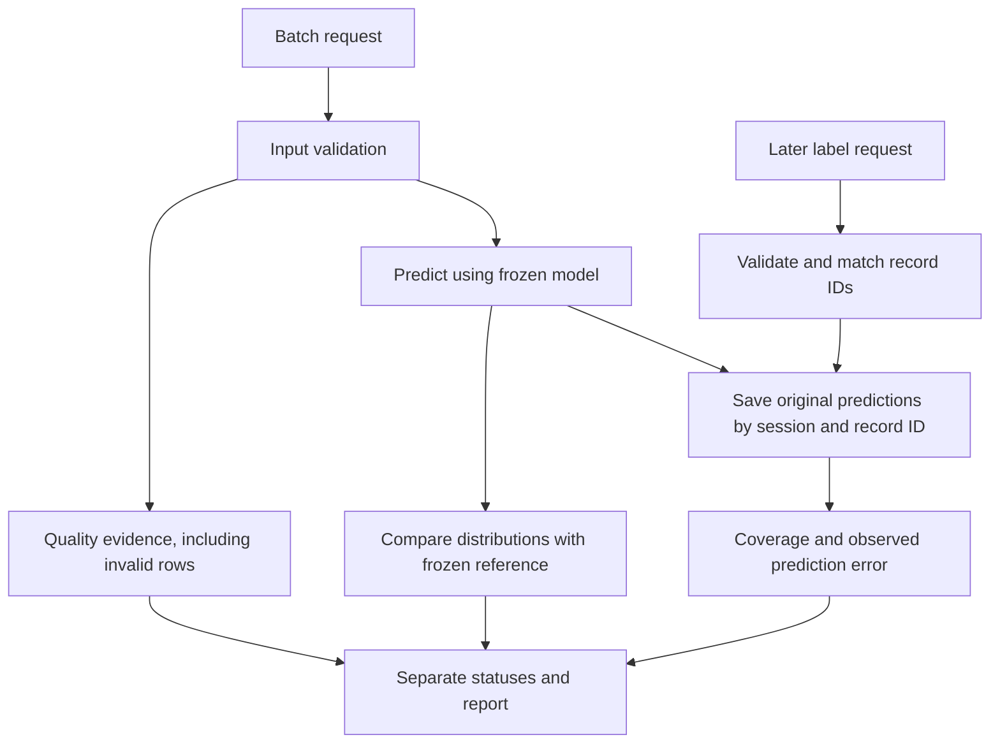

# Draft batch and label contract

18 November 2026 · Day 1 · Assistant-proposed draft; learner review pending

This contract describes the intended information exchanged by a caller and ShiftWatch. It is not an implemented batch/label API or a frozen dataset schema. Only GET `/health` currently exists. A small label-shape validator now exists in `src/shiftwatch/contracts.py` and is exercised directly, without storage or HTTP integration. JSON examples under `examples/contracts/` contain invented values and deliberately incomplete feature sets; do not present them as audited UCI records or model-ready uploads.

## The user and the decision

ShiftWatch helps an engineer maintaining one batch regression model investigate malformed inputs, changed input/prediction patterns, and observed prediction error. An alert should identify its evidence and support investigation. Feature change alone does not establish worsening error. The demonstration estimates hourly rentals using contemporaneous weather; it does not establish advance demand forecasting.

## Proposed batch request

Intended route: POST `/sessions/{id}/batches`, with access checked against that session. A session is one isolated visitor's workspace. Session creation, tokens, retention, and authorization will be taught and implemented separately; no global shared prediction history.

| Field | Proposed meaning | Why it exists |
|---|---|---|
| `batch_id` | Caller-supplied stable identifier for this submitted group | Recognize a retry of the same submission. |
| `records` | List of input records | Process a bounded group together. |
| `record_id` | Stable identifier unique across records in a session | Attach later outcomes to the correct original prediction. |
| `event_time` | Date/hour the record describes | Preserve event order; this is distinct from server receipt time. |
| `features` | The audited model-input fields, once defined on Day 2 | Keep prediction inputs separate from routing metadata and later outcomes. |

`examples/contracts/batch.json` illustrates the shape with two invented records. `temp`/`hum` are provisional names from the plan, not a finalized allowlist. Exact fields, definitions, ranges, categorical representation, timestamp/time-zone policy, and CSV mapping depend on the actual archive/README audit. The example omits fields that the final model will require. Do not silently assume a local timestamp is UTC.

The actual count `cnt`, its components `casual`/`registered`, record IDs, and evaluator/scenario metadata cannot become predictor features. No dataset download or feature audit has happened yet.

Initial proposed workload bounds from the plan: 500 rows and 256 KB per batch, 24 prediction batches per session, and one bounded replay at a time. These are intended limits, not measured capacity.

## Proposed prediction behavior and response

Validate inputs before inference. Retain immutable original predictions with record/session/batch identity, event/receipt times, and model/reference/policy versions. The exact response schema is not frozen. It must identify the batch, report accepted/rejected counts and record errors, and return separate quality, distribution, and observed-performance information with eligibility/coverage.

The whole-batch versus partial-row rejection choice still needs its guided design review before Day 4 implementation. Regardless of the choice, invalid rows must remain visible in quality evidence and cannot become misleading model-error measurements. Do not quietly drop invalid rows into a healthy result.

## Proposed label request

Intended route: POST `/sessions/{id}/labels`, with the same session ownership checks. A label item contains `record_id` and actual `cnt`. See `examples/contracts/labels.json`; its item order intentionally differs from the batch order.

Labels attach by `(session_id, record_id)`, never row position. The server records label receipt time. Replay controls label availability and exposes only eligible labels at each step; accepting a client-supplied future time is not a substitute. The two-batch delay is simulated.

The current draft `LabelRecord` schema requires a text ID of 1–64 non-whitespace characters and a nonnegative integer `cnt`. Strict types and rejection of unexpected fields make malformed values visible. These are application/label-shape rules, not the audited input-feature schema. The validator does not check whether an ID exists, enforce availability, apply retries, or store labels. Those later checks remain required.

Retry behavior follows the plan: identical retries must not duplicate predictions, labels, or metric contributions; conflicting submissions/labels and unknown IDs must fail explicitly. Cross-request transactions, uniqueness constraints, duplicate/conflict semantics, and HTTP responses need later implementation/tests. The tiny teaching trace implements none of that lifecycle.

Before labels, observed performance is unknown. With partial labels, show coverage and descriptive observed error without calling the whole batch healthy. Performance-alert eligibility follows the plan's fully labeled, matured-batch rules; a two-record teaching example is ineligible for monitoring statistics/alerts.

## Architecture sketch for the intended workflow

This is a draft intended architecture, not a verified implemented pipeline. Replay supplies batches and separately withheld labels; evaluator-only scenario truth cannot enter the predictor or monitor. The batch/label requests will share services with offline replay.

## Decision record

Requirement: a delayed outcome must attach to the prediction made for the same record, despite arrival order. Alternatives: match by list position or stable record ID. Proposed choice: stable ID within an isolated session. Evidence: the runnable invented example pairs reversed outcomes correctly by ID. Cost: store identity and enforce uniqueness/conflict rules. Reversal condition: redesign the identity scheme only if supported input identity requirements change, with explicit migration/versioning and regression evidence. Positional matching is incompatible with reordered outcomes.

Learner explanation and schema/architecture review are pending. Source/data assumptions remain open for Day 2.
