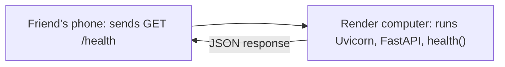

# Day 1 close-out and stopping point

Closed on 21 November 2026, Asia/Calcutta: **Day 1's core pass criteria are met. Stop here; Day 2 has not started.** This closes the foundation milestone, not the complete ML project or every later ownership exercise.

## What was checked

| Day 1 requirement | Actual evidence |
|---|---|
| Problem statement, draft contracts, architecture | Checked `docs/day01-problem-design.md` and `docs/batch-label-contract.md` against the plan. They distinguish quality, distribution, and observed error; retain predictions and join delayed labels by ID. Feature schema and production behavior remain unfrozen for later work. |
| Environment and Git | Pinned web dependencies, working local Python service, reviewed commits pushed to the canonical repository. Git's narrow staging/history/push check passed after correction/retest. |
| Initial Docker and deployment setup | Clean Linux container CI passed six tests and real HTTP checks. Approved Render Free deployment succeeded. Local Windows Docker engine remains an explicitly recorded limitation. |
| Public health endpoint | `https://shiftwatch-iejl.onrender.com/health` returned 200 with `{"status":"ok"}`. Unsupported method 405 and missing route 404 also observed. Raw output, source/deployment identity, screenshot, and hashes are saved in `reports/day01/hosted-2026-11-21/`. |
| Required monitoring distinction | Learner correctly explained that changed input frequencies need not worsen error while estimates remain accurate. Missing-label and narrow ID checks also passed; do not repeat them as new prerequisites. |
| Reading and review facts | Learner reported the planned 45-minute DMLS Chapter 2 selection completed. This is reported reading, not proof of mastery or a measurement of total learner hours. Tester status: no confirmed person. |

## The last hosting explanation

The learner initially answered "I don't know" when asked where `health()` executes after the laptop is switched off. Re-taught the concept using the actual deployment: Render started a separate copy of our Python application on its computer. The laptop was used to edit and deploy the code. A friend's phone is a client: it sends a request, then receives the response produced by the hosted application.

Guided retest: does the phone execute our Python function, or receive the result from Render? Learner answer: "It recieves it from Render's computer." Correct after the worked explanation. This passes that narrow guided check; independent service troubleshooting or a complete unaided architecture walkthrough is not established.

The earlier narrow Docker build/run/port retest was also correct. No additional Day 1 feature lesson or repeat of those passed questions is required.

## Open follow-ups, not completed claims

- No tester is confirmed; outreach-attempt status was not provided. Retain recruitment as an open follow-up before the Day 11 trial. Do not claim an invitation, agreement, trial, external validation, or adoption. The plan permits retaining an unavailable-tester gap openly; no one has been contacted by the assistant.
- Local Windows Docker operation is unresolved. Linux CI and Render verified the container path; that does not establish a working local engine. Keep the limitation tracked for operational/reproduction work.
- Further validation/code traces and the four independent core exercises are future learning work. No claim of independent PSI/evaluator/join/debugging proficiency is made.

These follow-ups remain visible. They do not turn into extra foundation feature lessons or a claim that all project work is complete.

## Exact stopping boundary

The stopping point is **the end of Lesson 6, after this closing review**. The build, recorded evidence, required monitoring explanation, narrow hosting retest, reading report, and open tester/setup gaps have now been reviewed. Save the handoff and push this close-out, then end the session.

Day 2 begins only when the learner later asks to resume. Its first task is the actual UCI Bike Sharing archive/schema/terms audit. No dataset download, model training, monitoring implementation, frontend work, or final evaluation was started during this close-out.

The existing calendar is unchanged: release target 29 November, outer deadline 1 December, with the final reserve protected. Closing Day 1 on 21 November leaves the release target at risk. Total learner hours remain unknown.
