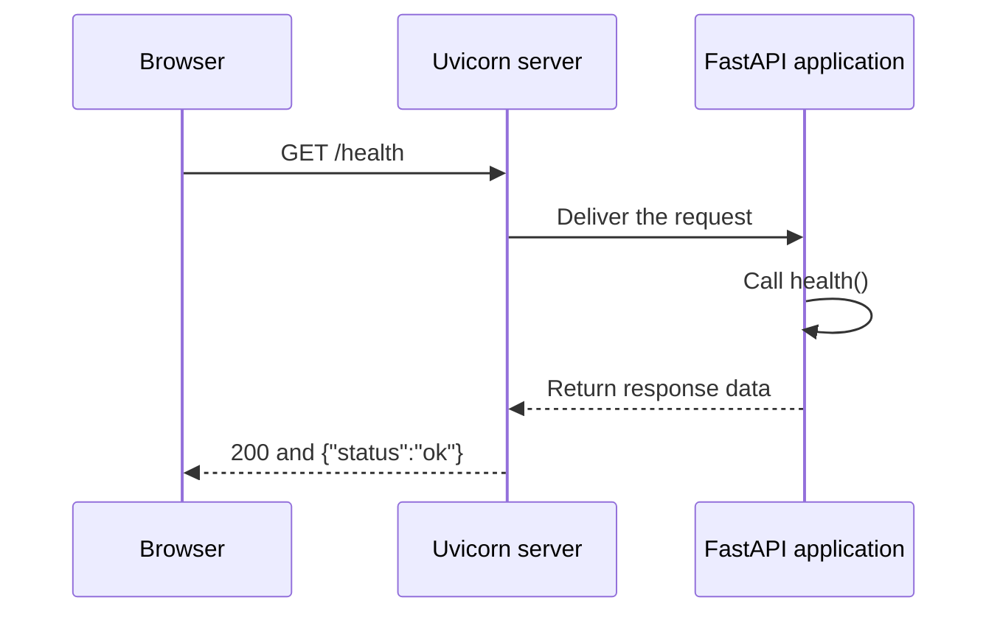

# Lesson 1: give ShiftWatch a way to answer

18 November 2026 · Day 1 · A first working slice

## Begin with the problem we already understand

You answered the opening question correctly: "We can't measure its prediction performance without labels." A prediction is an estimate. Measuring its error requires an actual outcome to compare against it. This is one reason ShiftWatch must say what it knows rather than present one unexplained healthy/unhealthy light.

We will eventually build a model that estimates hourly bike rentals, then build checks around it. The estimate uses weather observed during those hours; it is a retrospective estimate rather than a claim to know future weather. For now, we need a small foundation: a running Python application that another program can talk to.

## From a Python function to a service

In a notebook, you can call a function directly. A visitor using our future web page cannot directly call a function inside your Python process. The browser needs an agreed way to ask that process to do something and receive its answer.

We will use HTTP, the request-and-response protocol browsers use to communicate with web services. For this first request, the browser asks for information using the method `GET`. The address ends in `/health`, which tells the application which operation is wanted. An operation available at a particular method and path is often called an endpoint.

The first endpoint has a deliberately small job: confirm that the application can answer a request. This is a liveness check. A successful answer does not establish that a future model is accurate, that a database is available, or that the full monitoring workflow works. Those claims need their own evidence.

The request travels through three steps:



FastAPI is the Python library that connects a request to the function that handles it. Uvicorn runs the server that listens for requests and delivers them to the application. We use separate tools for these jobs so our application code can focus on its behavior.

## Build the first piece

The application lives in `src/shiftwatch/api.py`:

```python
from fastapi import FastAPI

app = FastAPI(title="ShiftWatch")


@app.get("/health")
def health() -> dict[str, str]:
    """Confirm that this application can respond to a request."""
    return {"status": "ok"}
```

The import brings the `FastAPI` class into this file. `app = FastAPI(...)` creates the application object that will hold our routes. A route is the connection between a method/path and the function that handles it.

The line `@app.get("/health")` registers the function immediately below it for `GET /health`. In Python, this kind of line is called a decorator. For this example, read it as: "When a GET request arrives for `/health`, call `health`."

`def health()` defines the function. It needs no arguments because this request does not submit data. The `-> dict[str, str]` part is a type annotation: it describes the returned object as a dictionary whose keys and values are strings. The quoted sentence inside the function documents its purpose.

The return statement creates a Python dictionary. FastAPI turns it into a JSON response. JSON is a text format for exchanging structured values; here the browser receives the key `status` with the text value `ok`. The HTTP response also has status code `200`, meaning the request succeeded.

We have implemented only this operation. We will add prediction, batch, label, and report behavior as we teach those parts.

## Why these files exist

Source code belongs under `src/shiftwatch/`, so it has a clear home as the project grows. The small `__init__.py` file identifies `shiftwatch` as a Python package—a group of modules that Python can import. `api.py` is the module containing this application.

We also created `.venv/`, a virtual environment containing this project's interpreter entry points and installed libraries. It uses the installed Python 3.13.3 without changing other projects' libraries. `requirements.txt` records the exact library versions resolved and installed for this working slice. This is the beginning of repeatable setup, not yet a full clean-machine reproduction check.

Git tracks changes to project files. The local repository has been initialized on branch `main`; there is no commit or remote yet. `.gitignore` tells Git to leave out local environments, temporary files, credentials files, and generated data/database files. We will teach commits and artifact tracking before relying on them for experiments.

## Run it yourself

Open Git Bash in `D:\good_projects\shiftwatch`. The environment and dependencies have already been created in this workspace. Run:

```bash
./.venv/Scripts/python.exe -m uvicorn shiftwatch.api:app --app-dir src --host 127.0.0.1 --port 8000
```

`./.venv/Scripts/python.exe` selects this project's Python explicitly. `-m uvicorn` asks that Python to run Uvicorn. `shiftwatch.api:app` names the `app` object in the `api` module of the `shiftwatch` package. `--app-dir src` tells Uvicorn where to find that package.

`127.0.0.1` means this computer. Port `8000` identifies the local listening point. Together they give the local base address `http://127.0.0.1:8000`. This is local access, not a public deployment. The terminal stays occupied while the server is running; press Ctrl+C to stop it.

While it is running, open <http://127.0.0.1:8000/health> in a browser. Its response should be:

```json
{"status":"ok"}
```

The Python/Uvicorn invocation was executed during the verification described below. The learner's own Git Bash/browser run has not yet been observed.

## Check what actually happened

The assistant started Uvicorn, made real local HTTP requests, and recorded the results in `reports/day01/2026-11-18/health-smoke.json`:

| Request | Observed result | Meaning |
|---|---|---|
| `GET /health` | 200, `{"status":"ok"}` | The health handler answered. |
| `GET /missing` | 404 | There is no route at this path. |
| `POST /health` | 405 | The route exists but does not support this method. |
| `GET /openapi.json` | 200; `/health` is the only documented application path | The generated API description agrees with this small application. |

The temporary server was stopped after verification. These are local application checks, not model tests, hosted availability, or learner understanding evidence. Dependency consistency was also checked with `pip check` and passed.

Setup exposed two environment issues. Python initially could not write its temporary installation files. Keeping temporary files inside the writable project folder fixed that. The execution sandbox blocked network/package access and local socket connections; approved execution outside those restrictions allowed the installs and HTTP verification. We did not change the health function to work around an unrelated network restriction. The symptom, smallest check, and resolution are recorded in `reports/day01/2026-11-18/SESSION.md`.

## One check before the next piece

A browser receives `{"status":"ok"}` from `/health`. Does that tell us the bike-rental model is predicting accurately, or only that this application answered the request? Explain using what this handler actually does.

No answer has yet been assessed. Next we will write the draft batch/label contract—the agreement about what data the application receives and what it returns—using a concrete example before introducing more code.

## Further reading

The [official FastAPI first-steps tutorial](https://fastapi.tiangolo.com/tutorial/first-steps/) documents the application object, route decorator, handler, and returned response. DMLS Chapter 2 remains today's supplementary reading for objectives and requirements; neither reading replaces this lesson or requires a new independent design beforehand.
