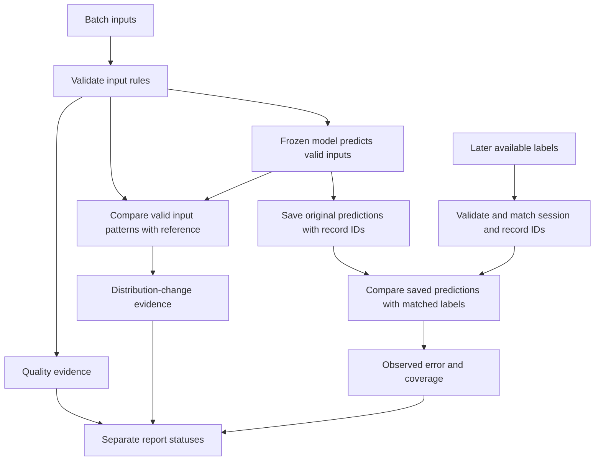

# Lesson 4: follow one batch through the intended system

18 November 2026 · Day 1 · Architecture and report-design review

## Connect what we have built

You correctly chose the saved prediction 120 using record_id in the counterexample. The actual label was 90; its absolute error was 30. The narrow ID-reasoning retest is passed. Predicting, matching identity, validating a message, and measuring error now have distinct jobs in our design.

So far, the application can answer a health request. A separate small schema checks one label's shape, and a teaching script illustrates matching by ID. The next step is to connect these ideas in the architecture before filling in more components. Architecture describes the parts of the system, their responsibilities, and how information travels between them. This lesson reviews the intended pipeline; it does not claim that it already runs.

## A batch arrives before its outcomes

Imagine an engineer submits a batch containing 240 hourly observations. These counts and events are invented for teaching. Each observation has an ID, an event time, and the input features needed by our future model.

First, we check inputs against the agreed rules. A required numeric field containing text is an input problem, so the quality report must expose it before inference. We still need the data audit to establish the complete feature rules, and a guided decision on whole-batch versus partial-row rejection. Regardless of that decision, malformed rows cannot quietly disappear into a healthy result.

Valid inputs go to a frozen model, meaning we use a particular saved model version rather than retraining on every request. It produces estimates. We save each original estimate with identity, time, and version information, so that later labels are compared with the prediction actually made. Model fitting and this storage lifecycle are future work.

We can also compare the patterns in the current valid inputs and predictions with a reference: an earlier comparison sample that we keep fixed. This asks whether the mix of values differs, such as whether many more records describe warm hours. Statistical checks and their limitations will be taught and implemented later.

At this stage, we can have evidence about input validity and changed patterns. Without actual outcomes for this batch, its prediction error is still unknown. We must not use old batches' measured error as if it measured the current unlabeled batch.

## Labels open a second path

When labels become available, we validate them, check their session and record IDs against saved history, and apply the later duplicate/conflict rules. Then we compare them with the original saved predictions. This makes observed error available for the records whose labels we actually received.

We also report coverage: received valid labels divided by predictions for the batch. For 240 predictions and no labels, coverage is 0/240. For 24 labels, it is 24/240, or 10%. That second case lets us describe observed error on those 24 records; it does not justify concluding that the whole batch is healthy. Labels may arrive selectively.

The replay will withhold labels for two steps to test this behavior. Availability filtering, ID joins, immutable predictions, and idempotent retries still need their later implementation and tests. A diagram or teaching script is not that implementation.

## Three questions require three statuses

| Channel | What it asks | What a reassuring result establishes |
|---|---|---|
| Data quality | Do records pass the declared input rules? | Those rules passed; it does not establish prediction accuracy. |
| Distribution change | Do current input/prediction patterns differ from the reference under our checks? | No change was detected by those checks when eligible; it does not prove all distributions or errors are unchanged. |
| Observed performance | What errors do saved predictions have on received outcomes? | An eligible observed-error measurement is below the frozen threshold for that evaluated population; coverage and limitations still matter. |

Insufficient samples must say insufficient data. An unexecuted check must not be displayed as a passed check. Missing labels mean unknown performance. Partial labels are descriptive evidence with coverage, not an eligible full-batch performance-alert conclusion.

Suppose the quality checks pass, the inputs contain more warm hours, and no labels have arrived. The report can say: declared quality checks passed; distribution change detected; observed performance unknown with 0% coverage. All three statements can be true together.

Later, suppose all labels for an eligible batch arrive and the measured error remains below the frozen threshold. The temperature-change notice can remain while the observed-error measurement is acceptable. A model may already handle warm hours accurately even when their frequency increases. Conversely, valid and familiar input values cannot guarantee low prediction error if the relationship between inputs and outcomes changes.

## Architecture sketch

This is the intended design, not a verified runtime pipeline. SQLite will store the session/batch/prediction/label history; the FastAPI service will call the same monitoring services used by offline replay. The interface will display those results later. No extra server or frontend is being implemented in this lesson.

The draft report example at `examples/reports/unlabeled-batch.json` expresses the three separate statuses. Its assumptions are explicitly synthetic; no detector ran, no model produced its hypothetical predictions, and it is not a live API response. The exact machine status names/complete report schema remain draft choices. This design artifact connects the written contract to the eventual report behavior without fabricating evaluation results.

## One check

Suppose an eligible batch has 240 valid predictions, all labels have arrived and been matched correctly, and its measured error is below our frozen error threshold. A temperature distribution-change warning is present. Should that warning automatically make the observed-performance status poor? Explain why.

Learner answer on 21 November: "It automatically shouldn't make the performance poor because newer inputs frequency increases while its estimates remain accurate."

Assessment: correct. The narrow distribution-versus-observed-error distinction is passed: a changed input mix can coexist with accurate predictions. This does not establish that the real model, detector, or threshold exists yet. Other validation/service explanations and the four later independent exercises still require their own evidence.
