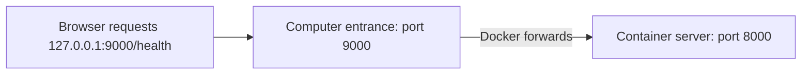

# Lesson 5B: carrying the service to another computer

Our Python files work with the libraries installed in this project's `.venv`. A different computer starts with a different environment. It might lack Python, lack FastAPI, or have incompatible library versions. Sending only `api.py` would leave those requirements unresolved.

We will give Docker a recipe for an environment containing Python, our required libraries, and our source code. Docker builds that recipe into an image. Starting the application from the image creates a running container.

The three terms describe three different things:

| Thing | Meaning in ShiftWatch |
|---|---|
| Dockerfile | The text recipe describing how to assemble the environment. |
| Image | The built package containing the runtime, libraries, source, and startup instructions. |
| Container | An instance created from that image, with its own process and writable layer. |

Building an image prepares the package. Running a container starts our server process. The recipe itself does not keep a server running.

## Read our actual recipe

Open the repository's `Dockerfile` alongside this explanation. It is deliberately one small stage because our current application only needs Python libraries and source files.

`FROM python:3.13-slim@sha256:...` starts from an official Python image with a small Linux environment. The full digest after `sha256:` identifies the exact base we inspected, rather than allowing a changing tag to silently select a new base. It is a multi-platform image index; this initial verification targets Linux amd64. Updating the base later is an explicit change followed by new checks. Our local Python was 3.13.3; the inspected container base reports Python 3.13.18, so compatibility must be tested rather than assumed.

The `ENV` instructions configure Python. `PYTHONPATH=/app/src` tells it where our `shiftwatch` package lives. `PYTHONUNBUFFERED=1` makes process output appear promptly in logs. `PYTHONDONTWRITEBYTECODE=1` avoids generating compiled Python cache files inside the running filesystem.

`WORKDIR /app` chooses the working folder inside the image. This is a Linux path inside the container, separate from the Windows project path.

`COPY requirements.txt .` copies our dependency list there. `RUN python -m pip install ...` installs those exact library versions while the image is being built. The following `pip check` checks installed dependency compatibility. We copy requirements before source so Docker can reuse the library-installation layer when only our application code changes.

`COPY src ./src` then adds our application. We do not copy the existing Windows `.venv`; the Linux image installs its own libraries from the requirements file. The `.dockerignore` allowlist limits the build context to the current recipe, requirements, and source, keeping temporary files and unrelated project material out of the build input. Later model artifacts will need an explicit packaging change when they exist.

`USER 10001:10001` runs the service with a non-root numeric user and group. The current service only needs to read its packaged files. A writable SQLite directory and storage behavior will be designed when persistence is implemented.

`EXPOSE 8000` documents the intended container port. Publishing a host port still requires an option when starting the container.

Finally, `CMD` defines the default startup command:

```text
python -m uvicorn shiftwatch.api:app --host 0.0.0.0 --port 8000 --workers 1
```

This starts Uvicorn, which imports our FastAPI application. Binding to `0.0.0.0` lets the server receive connections through the container's network interface. Port 8000 is where it listens, and one worker preserves our planned single-process service shape. This is the command executed when the container starts; `RUN` instructions above execute during the image build.

## Follow a request through the package

The intended command pair, from the repository root in Git Bash, is:

```bash
docker build --tag shiftwatch:dev .
docker run --rm --publish 127.0.0.1:8000:8000 shiftwatch:dev
```

The final dot in the build command selects this folder as the build context. `--tag` gives the resulting image the local name `shiftwatch:dev`.

The run command starts a container from that image. `--publish 127.0.0.1:8000:8000` connects port 8000 on this computer's loopback address to port 8000 in the container. `--rm` removes that container when it exits; it does not delete the built image. Ctrl+C stops this foreground server.

With the container running, a request to `http://127.0.0.1:8000/health` crosses that port mapping, reaches Uvicorn, and calls our existing `health()` function. Its response is `{"status":"ok"}`. This remains a liveness check; prediction quality still requires predictions matched with labels.

## Verify the package rather than assuming it works

The local Docker engine returned an API error during this lesson, so a successful local build/run is not claimed. The command pair above is the intended local usage; the actual automated command variants are in `.github/workflows/verify.yml`.

That file defines continuous integration (CI): automatic checks when relevant source, test, or packaging files change. It uses a standard GitHub-hosted Ubuntu runner for our public repository, with a ten-minute job limit. It checks out the source at the pushed revision, builds the image from a clean machine, records its image ID/Python version, runs four schema tests and two startup-checker regression tests inside it, starts a container, and checks real HTTP responses. It cleans up the container afterward. Documentation-only changes do not rerun these runtime checks.

`scripts/smoke_health.py` is the small HTTP checker. Its loop waits briefly while a connection is unavailable, reset, or timed out during server startup. Once connected, it requires health status 200 with the expected JSON body, POST `/health` status 405, and a missing route status 404. An unexpected response raises an error so CI fails. It prints observed results as JSON for inspection. The checker uses Python's standard library and adds no dependency.

The first run exposed a bug in my checker: Docker had created the container, but Uvicorn was still starting. An immediate request received `ConnectionResetError`, which the original retry did not catch. The image build and four schema tests passed, but that HTTP step failed. I extended the bounded retry to cover these transport errors and added regression checks for recovery and immediate failure on actual HTTP errors. This is a useful distinction: creating a container does not prove the application is ready to answer requests. The failed run is retained in the packaging report.

The workflow can succeed only after an actual run; its mere presence is not passing evidence. The verified outcome and any limitations are recorded in `PROJECT_STATE.md` and the packaging report. A CI container test also does not deploy a continuously available public app.

The corrected [run 44899459409](https://github.com/AdityaChhimwal/ShiftWatch/actions/runs/44899459409) on source `a4e4ad4` passed on 21 November. It built the image from the pinned base, reported Python 3.13.18, passed dependency consistency and all six tests, and observed the expected 200/405/404 responses. The failed and passing logs plus the built image ID are retained in `reports/day01/packaging-2026-11-21/`. This verifies one clean Linux amd64 build and run; the local Windows engine remains unavailable. We did not publish the built image to a registry or deploy a public service.

## One check

We successfully run `docker build` and have an image, but have not run a container. Is `/health` now being served by that image, or what still needs to happen?

The learner first answered "It still need to send a request." That omits starting the container. Explained that `docker run` starts the container and executes its startup command before a request can receive a response. The subsequent response used `docker build` for both building and starting; clarified again that the startup command is `docker run`. Do not infer a passed build/run distinction from that response. Git's staging/local-history retest is passed separately in Lesson 5A.

## Follow the request from outside the container

The next worked example used the hypothetical mapping `127.0.0.1:9000:8000`, with the container already running and its application listening on port 8000. Asked which browser URL to use, the learner selected `http://127.0.0.1:8000/health`. For this mapping, the correct browser URL is `http://127.0.0.1:9000/health`.

The browser begins on the computer outside the container. It must enter through the computer's published port, 9000. Docker then forwards that connection to the application's port, 8000, inside the container:



Read the mapping as `computer address : computer port : container port`. The two ports do different jobs; they can have different numbers. The server stays on 8000 inside the container even when the browser uses 9000 outside. This is an explanatory mapping, not a separately executed 9000-port experiment. The verified CI mapping used 8000 on both sides, which can hide this distinction.

Combined narrow retest: complete the trace for this example: `docker ____` starts the container; then the browser requests `http://127.0.0.1:____/health`.

The learner answered the combined retest: "docker run starts the container, with mapping 9000:8000, the browser connects to port 9000." Correct after correction/retest. This passes the narrow build/run and computer/container port check; it does not establish independent Docker troubleshooting proficiency. The running package and CI results remain verified separately from learner understanding.

Sources: [Dockerfile instructions](https://docs.docker.com/build/concepts/dockerfile/), [Docker build practices and digest pinning](https://docs.docker.com/build/building/best-practices/), [GitHub workflow syntax](https://docs.github.com/en/actions/reference/workflows-and-actions/workflow-syntax), and [standard public-runner billing](https://docs.github.com/en/billing/concepts/product-billing/github-actions).
