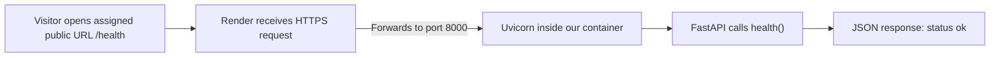

# Lesson 6: letting another person reach our service

Our container can run a server, but a server on a laptop is only available while that laptop and process are available. Also, `127.0.0.1` always means the computer making the request. If a friend opens our old localhost address on their laptop, they are contacting their own laptop, not ours.

Deployment gives this server a home on another computer. A hosting provider runs the application there and supplies a public address that visitors can use. Our plan's first candidate is Render, using its free Docker web-service option. Account eligibility, quota, and billing still need inspection before launch.

GitHub and a host do different jobs. GitHub stores our source and history. GitHub Actions built the image and ran a temporary verification; its job deliberately removed the container afterward. That successful check did not leave a public server running. Render would build the source again from our repository, start our Dockerfile's command, and manage the running service.

## Follow a future public request

Render's public-facing server is a proxy: it receives a request and forwards it to our application. Visitors use the assigned HTTPS address; they do not need to enter our container's internal port. Our server still listens on `0.0.0.0:8000`, which lets the proxy reach it through the container's network interface.

The actual public health address is now [https://shiftwatch-iejl.onrender.com/health](https://shiftwatch-iejl.onrender.com/health). It returned HTTP 200 with `{"status":"ok"}` in both the public HTTP check and browser. Our current application has no route for `/`, so a 404 at the bare address does not by itself establish that `/health` is broken.

## What we prepared in render.yaml

`render.yaml` is a Blueprint: a file describing the resources and settings we propose to create. It records our choices so they can be reviewed rather than remembered from dashboard clicks. Merely committing it does not create a service.

`type: web` requests a public web service, and `runtime: docker` tells Render to build our Dockerfile. `repo`, `branch`, `dockerfilePath`, and `dockerContext` point to this repository's main branch and the existing recipe/build folder. We omit a startup override so Render uses the same Dockerfile `CMD` verified in CI.

`plan: free` explicitly requests free compute. This matters because omitting the plan can select a paid default. `region: singapore` is the proposed location; availability and workspace eligibility remain to be checked. The documentation lists the free service as 0.1 CPU and 512 MB RAM. Those are published resources, not measured capacity for our future model.

`autoDeployTrigger: "off"` keeps ordinary source-commit pushes separate from public deployments. We can keep publishing lesson progress and deliberately deploy a checked revision when ready. Blueprint configuration sync is a separate mechanism: the creation screen says future changes to `render.yaml` sync automatically and may change costs. This setting alone does not turn off those configuration updates. Review future Blueprint changes before publishing them.

`healthCheckPath: /health` tells Render which HTTP route to check for a responding application. It does not measure prediction quality. `PORT: "8000"` aligns Render's configured port with our existing fixed startup command. That environment setting alone does not rewrite the Dockerfile's `--port 8000`; changing the port later requires keeping the two settings consistent and rechecking them.

## Understand the free host's limits

The current free-service documentation describes idle spin-down after 15 minutes, a cold start on a later request, and 750 shared free instance hours per workspace each month. Files changed by the running service can disappear on restart, redeploy, or spin-down. Therefore, our later hosted SQLite sessions will be temporary; durable session storage is not promised.

Free compute does not establish every aspect of a workspace's billing behavior. We inspected bandwidth/build usage, payment status, spending controls, and remaining quota on the actual account before creation. The approved Blueprint created one free web service, with no database, disk, paid compute, or extra service. No workspace or billing setting changed.

## What has actually been checked

The YAML parsed successfully, and nine project-specific checks passed: one free Docker web service, canonical source/branch, manual deploys, matching port, externally reachable bind address, one worker, implemented GET health path, existing Docker paths, and no disk/database request. The saved result is in `reports/day01/hosting-prep-2026-11-21/validation.json`.

This was local consistency checking, not Render's validator or a deployment test. A direct download of Render's published schema returned a Cloudflare challenge. The first Windows-browser inspection also stopped because the tool could not verify its current URL. A later in-app browser handoff let the learner sign in to the existing account. We then inspected workspace quota, spending controls, and billing configuration without changing them. Detailed account/billing evidence stays local.

After reviewing the concrete creation form, the learner instructed us to continue. We created the `ShiftWatch` Blueprint and its `shiftwatch` Docker web service. Render reported `Deploy succeeded | Live` for source `5ccc2a4fa6b023d3819abf3f74ac8917964271fb` on the Free plan. Its visible deployment duration was 38.2 seconds, which is not a request-latency or cold-start benchmark.

We ran the same HTTP checker against the actual public URL: health returned 200 with the expected JSON, POST to the GET-only health route returned 405, and a missing route returned 404. We also opened `/health` in a browser and saw the JSON. Deployment identity, source hashes, raw HTTP output, a redacted visible dashboard observation, and the screenshot are saved under `reports/day01/hosted-2026-11-21/`. The original dashboard observation stays local because it includes internal addresses. Runtime files match the source that passed the six CI tests; those tests were not rerun on the host itself.

This connects the full path: a visitor contacts the public address, Render forwards the request to our container, Uvicorn receives it, and FastAPI runs `health()`. Your laptop is no longer the machine serving this public response. Free-host limitations still apply. Day 1's hosted-health requirement is met; the remaining learner/review gaps remain explicit.

## One taught check for the later review

When your laptop is switched off, which computer would handle a friend's request to this public health URL? Explain using where Uvicorn is now running.

This check is unassessed and is the immediate next task. Correct Docker answers are already recorded separately; they are not being repeated as new prerequisites.

Sources checked on 21 November 2026: [web services and port binding](https://render.com/docs/web-services), [Blueprint fields](https://render.com/docs/blueprint-spec), [health checks](https://render.com/docs/health-checks), and [free-service limitations](https://render.com/docs/free).
