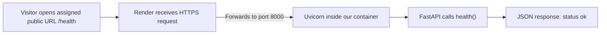

# Lesson 6: letting another person reach our service

Our container can run a server, but a server on a laptop is only available while that laptop and process are available. Also, `127.0.0.1` always means the computer making the request. If a friend opens our old localhost address on their laptop, they are contacting their own laptop, not ours.

Deployment gives this server a home on another computer. A hosting provider runs the application there and supplies a public address that visitors can use. Our plan's first candidate is Render, using its free Docker web-service option. Account eligibility, quota, and billing still need inspection before launch.

GitHub and a host do different jobs. GitHub stores our source and history. GitHub Actions built the image and ran a temporary verification; its job deliberately removed the container afterward. That successful check did not leave a public server running. Render would build the source again from our repository, start our Dockerfile's command, and manage the running service.

## Follow a future public request

Render's public-facing server is a proxy: it receives a request and forwards it to our application. Visitors use the assigned HTTPS address; they do not need to enter our container's internal port. Our server still listens on `0.0.0.0:8000`, which lets the proxy reach it through the container's network interface.

The public hostname will be assigned when a service is actually created. No public URL has been verified yet. Once deployed, we must test the assigned address with `/health` appended. Our current application has no route for `/`, so a 404 at the bare address would not by itself establish that `/health` is broken.

## What we prepared in render.yaml

`render.yaml` is a Blueprint: a file describing the resources and settings we propose to create. It records our choices so they can be reviewed rather than remembered from dashboard clicks. Merely committing it does not create a service.

`type: web` requests a public web service, and `runtime: docker` tells Render to build our Dockerfile. `repo`, `branch`, `dockerfilePath`, and `dockerContext` point to this repository's main branch and the existing recipe/build folder. We omit a startup override so Render uses the same Dockerfile `CMD` verified in CI.

`plan: free` explicitly requests free compute. This matters because omitting the plan can select a paid default. `region: singapore` is the proposed location; availability and workspace eligibility remain to be checked. The documentation lists the free service as 0.1 CPU and 512 MB RAM. Those are published resources, not measured capacity for our future model.

`autoDeployTrigger: "off"` keeps ordinary Git pushes separate from public deployments. We can keep publishing lesson progress and deliberately deploy a checked revision when ready.

`healthCheckPath: /health` tells Render which HTTP route to check for a responding application. It does not measure prediction quality. `PORT: "8000"` aligns Render's configured port with our existing fixed startup command. That environment setting alone does not rewrite the Dockerfile's `--port 8000`; changing the port later requires keeping the two settings consistent and rechecking them.

## Understand the free host's limits

The current free-service documentation describes idle spin-down after 15 minutes, a cold start on a later request, and 750 shared free instance hours per workspace each month. Files changed by the running service can disappear on restart, redeploy, or spin-down. Therefore, our later hosted SQLite sessions will be temporary; durable session storage is not promised.

Free compute does not establish every aspect of a workspace's billing behavior. Bandwidth/build usage, payment method, spend limits, remaining quota, and eligibility must be inspected on the actual account. This proposal contains no database, disk, paid compute, or extra service. We have not created any cloud resource or changed billing.

## What has actually been checked

The YAML parsed successfully, and nine project-specific checks passed: one free Docker web service, canonical source/branch, manual deploys, matching port, externally reachable bind address, one worker, implemented GET health path, existing Docker paths, and no disk/database request. The saved result is in `reports/day01/hosting-prep-2026-11-21/validation.json`.

This was local consistency checking, not Render's validator or a deployment test. A direct download of Render's published schema returned a Cloudflare challenge. Browser inspection also stopped because the tool could not verify the current Windows browser URL. We stopped browser actions; no account, workspace, payment setting, or service was inspected or changed.

Before launch, establish account access, inspect the actual limits/billing settings, review the proposed free-service creation, and resolve the required authorization. After deployment, verify the public response and save the actual source/deployment identity and raw HTTP evidence. Day 1 remains partial until these and its remaining learning/review gates pass.

## One taught check for the later review

After deployment, which computer runs Uvicorn: your laptop or Render's computer? Explain why another person should use the assigned public address instead of `127.0.0.1`.

This check is prepared but unassessed. Account readiness is the immediate next task.

Sources checked on 21 November 2026: [web services and port binding](https://render.com/docs/web-services), [Blueprint fields](https://render.com/docs/blueprint-spec), [health checks](https://render.com/docs/health-checks), and [free-service limitations](https://render.com/docs/free).
